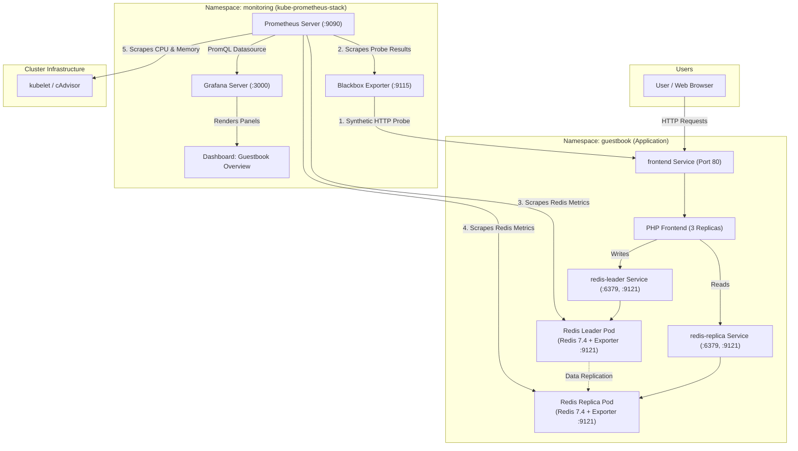

# Guestbook + Prometheus + Grafana (Pulumi / TypeScript)

This is a self-contained monitoring extension of Pulumi's [Kubernetes Guestbook `simple` example](https://github.com/pulumi/examples/blob/master/kubernetes-ts-guestbook/simple/index.ts). It deploys the original three-tier PHP/Redis Guestbook **plus** Prometheus, Grafana, Redis metrics exporters, a frontend HTTP probe, and a provisioned Grafana dashboard. The original upstream README is [here](https://github.com/pulumi/examples/blob/master/kubernetes-ts-guestbook/README.md).

> **Status:** TypeScript syntax and dashboard JSON were checked locally. Dependencies could not be installed here, so full TypeScript type-checking and a real `pulumi up` deployment have **not** been verified.

**Start here:** This README contains deployment instructions, monitoring verification, and submission details. A separate optional candidate walkthrough is provided outside the submission ZIP.

## Architecture



### Metrics covered

| Component | How monitored | Example PromQL |
| --- | --- | --- |
| Frontend | Blackbox HTTP GET against the frontend Kubernetes Service | `probe_success{job="guestbook-blackbox"}` |
| Frontend | HTTP probe duration | `probe_duration_seconds{job="guestbook-blackbox"}` |
| Frontend pods | Kubelet/cAdvisor metrics gathered by kube-prometheus-stack | `container_memory_working_set_bytes{namespace="guestbook",container="frontend"}` |
| Redis leader | Redis exporter sidecar (port `9121`) exposed through the backend Service | `redis_commands_processed_total{job="redis-leader"}` |
| Redis replica | Redis exporter sidecar (port `9121`) exposed through the backend Service | `redis_commands_processed_total{job="redis-replica"}` |

**Important limitation:** The original PHP frontend does **not** provide application-level request counters or HTTP error-rate metrics. `probe_success` measures whether a synthetic HTTP request succeeds, not how many users visit the site. The dashboard uses real probe, Redis, and container-resource metrics instead of fabricating request-rate/error-rate data. Real request counters would require modifying the PHP application or placing an instrumented reverse proxy in front of it.

## Prerequisites

- A working Kubernetes cluster (Kubernetes **1.25+** for the pinned monitoring chart), accessible via `kubectl` with sufficient RBAC to create cluster-scoped resources (Prometheus Operator and CRDs).
- Node.js 20+ and npm, [Pulumi CLI](https://www.pulumi.com/docs/iac/download-install/), and `kubectl`.
- Helm 3 is useful for troubleshooting but **not required**: the Pulumi Helm `Release` resource installs the chart.
- A cluster with approximately 4 vCPUs / 8 GiB RAM is recommended for local testing because the full monitoring stack runs multiple pods.
- Network access for Helm chart and image pulls.

All resources are created in the **`guestbook`** (application) and **`monitoring`** namespaces. The pinned Helm chart is `kube-prometheus-stack` version **89.2.0**. It also installs node-exporter and kube-state-metrics.

## Deploy on a cloud Kubernetes cluster

From this directory:

```bash
npm install
npm run test
kubectl cluster-info
pulumi stack init dev

# Required: set your own password, stored as a Pulumi secret.
pulumi config set --secret grafanaPassword 'REPLACE_WITH_A_STRONG_UNIQUE_PASSWORD'

# Default service type is LoadBalancer; explicitly set it if desired.
pulumi config set grafanaServiceType LoadBalancer

pulumi up
```

A cloud provider must support `LoadBalancer` Services for both the Guestbook frontend and Grafana to have public IPs/hostnames. Their URLs are populated once the provider assigns an address. If a LoadBalancer is assigned later than the initial update, run `pulumi refresh` to update the stored status.

## Deploy on Minikube / a local cluster

```bash
minikube start --cpus=4 --memory=8192
npm install
npm run test
pulumi stack init dev
pulumi config set --secret grafanaPassword 'REPLACE_WITH_A_STRONG_UNIQUE_PASSWORD'
pulumi config set isMinikube true
pulumi config set grafanaServiceType NodePort
pulumi config set nodeAddress "$(minikube ip)"
pulumi up
```

This uses a `ClusterIP` for the frontend and port **30300** as Grafana's `NodePort`. On host OS/network combinations where direct Minikube NodePort access does not work, use the reliable port-forward alternatives below. For kind or k3d, make sure a node IP/port mapping is accessible from the host or use port-forwarding.

## Grafana access details

Pulumi outputs:

| Output | Meaning |
| --- | --- |
| `grafanaUrl` | `http://<external-ip-or-hostname>` for LoadBalancer or `http://<nodeAddress>:30300` for NodePort |
| `grafanaAdminUser` | `admin` by default (overridable with `pulumi config set grafanaAdminUser ...`) |
| `grafanaAdminPassword` | The **secret** `grafanaPassword` you configured, shown only on explicit request |
| `grafanaDashboard` | Where to find the imported dashboard |
| `guestbookUrl` | Frontend LoadBalancer URL or local port-forward hint |
| `grafanaPortForward`, `frontendPortForward`, `prometheusPortForward` | Copy/paste shell commands for temporary local access |

Retrieve them after deployment:

```bash
pulumi stack output grafanaUrl
pulumi stack output grafanaAdminUser
pulumi stack output grafanaAdminPassword --show-secrets
pulumi stack output guestbookUrl
```

If a LoadBalancer external address is pending, check:

```bash
kubectl -n monitoring get svc monitoring-grafana
kubectl -n guestbook get svc frontend
```

You can access Grafana without any load balancer or public NodePort by running:

```bash
kubectl -n monitoring port-forward svc/monitoring-grafana 3000:80
# Open http://localhost:3000
```

Likewise, for the Guestbook:

```bash
kubectl -n guestbook port-forward svc/frontend 8080:80
# Open http://localhost:8080 and create a guestbook entry
```

Sign in to Grafana with the returned admin username and password. Open **Dashboards → Guestbook Overview**. The datasource is provisioned automatically by the Helm chart. The JSON used for the custom dashboard is in [`dashboards/guestbook.json`](dashboards/guestbook.json).

**Security:** Do not commit real passwords. An internet-facing Grafana LoadBalancer is for demonstration only; restrict exposure with cloud firewall/load-balancer rules, TLS and authentication, or keep Grafana internal and use port forwarding. Prometheus is `ClusterIP` only. The default setup stores monitoring data ephemerally (lab use, not production). The admin password is a Pulumi encrypted/secret stack value; only use `--show-secrets` on a trusted terminal.

## Verify Prometheus scraping

**1. Check workloads and ServiceMonitor custom resources.**

```bash
kubectl get pods -n guestbook
kubectl get pods -n monitoring
kubectl get servicemonitors -A
kubectl -n guestbook get svc redis-leader redis-replica frontend
```

Expected ServiceMonitors include `guestbook/redis-leader-monitor`, `guestbook/redis-replica-monitor` and `monitoring/guestbook-frontend-probe`.

**2. Open the Prometheus targets UI.**

```bash
kubectl -n monitoring port-forward svc/monitoring-kube-prometheus-prometheus 9090:9090
# Open http://localhost:9090/targets
```

Search for the targets created by the three Guestbook ServiceMonitors. The two Redis targets and the blackbox frontend target should show **UP** after at least one scrape. If a target is missing, check that the ServiceMonitor selectors match their Services and look at the Prometheus Operator logs.

**3. Run queries in Prometheus → Explore/Expression browser.**

```promql
up{job="redis-leader"}
up{job="redis-replica"}
up{job="guestbook-blackbox"}
probe_success{job="guestbook-blackbox"}
probe_duration_seconds{job="guestbook-blackbox"}
redis_commands_processed_total{job="redis-leader"}
rate(redis_commands_processed_total{job="redis-leader"}[5m])
sum(rate(container_cpu_usage_seconds_total{namespace="guestbook",container="frontend"}[5m]))
sum(container_memory_working_set_bytes{namespace="guestbook",container="frontend"})
```

The `up` values and `probe_success` should be **1** when all components are healthy. `up=1` means Prometheus scraped the exporter successfully; `probe_success=1` means the frontend URL itself returned a successful HTTP response. CPU and Redis `rate(...[5m])` need a few minutes of samples before producing lines.

**4. Check exporter endpoints directly if needed.** In a separate terminal:

```bash
kubectl -n guestbook port-forward svc/redis-leader 9121:9121
# Then: curl -s http://localhost:9121/metrics | grep '^redis_up\|^redis_commands_processed_total'
```

In another terminal, check the frontend probe via the blackbox exporter:

```bash
kubectl -n monitoring port-forward svc/guestbook-blackbox 9115:9115
# Then: curl -s 'http://localhost:9115/probe?module=http_2xx&target=http%3A%2F%2Ffrontend.guestbook.svc.cluster.local%2F' | grep '^probe_success\|^probe_duration_seconds'
```

For a quick smoke test of dashboards, open the Guestbook (port-forward as above) and add a few entries. This generates Redis traffic. You can also use `kubectl -n guestbook get pods` to verify the three frontend replicas are ready.

Alternatively, run `npm run traffic` (or `kubectl apply -f scripts/traffic-job.yaml`) to launch the automated in-cluster traffic generator, which produces sustained read/write load against Redis and the PHP frontend. Stop it anytime with `npm run traffic:stop`.

## Troubleshooting

- **Chart cannot install / CRD errors:** Ensure Kubernetes is 1.25+ and your `kubectl` identity can create CRDs and cluster roles. The `ServiceMonitor` resources explicitly depend on the Helm release to avoid a first-deploy CRD race.
- **No LB hostname/IP:** Your cluster may not implement cloud `LoadBalancer` Services. Use `NodePort` with a reachable node IP or use port forwarding.
- **Redis exporter is UP but `redis_up` is 0:** Check the Redis app container and `REDIS_ADDR=redis://127.0.0.1:6379` sidecar setting.
- **Frontend probe shows `probe_success=0`:** Check frontend pods are Ready, the frontend Service has endpoints, and Redis is reachable. The probe runs from the `monitoring` namespace against `http://frontend.guestbook.svc.cluster.local/`.
- **cAdvisor CPU/memory series are absent:** Verify the monitoring stack's kubelet targets are UP. Some managed Kubernetes installations restrict kubelet/cAdvisor scraping; see the cluster's security configuration.
- **Dashboard not visible:** Check `kubectl -n monitoring get configmap guestbook-grafana-dashboard --show-labels` and Grafana sidecar pod logs; the label `grafana_dashboard=1` enables auto-provisioning.
- **`npm run build` fails:** Ensure `npm install` completed successfully. TypeScript is checked against the installed Pulumi packages.

## Check locally and clean up

```bash
npm run check:dashboard   # validates dashboard JSON shape and expected metric queries
npm run build             # runs strict TypeScript validation
pulumi destroy           # removes resources managed by this stack
pulumi stack rm dev      # optional: deletes the Pulumi stack state
```

**Note:** Helm generally leaves its `monitoring.coreos.com` CRDs behind on uninstall. For a dedicated disposable cluster, remove them only after checking no other applications depend on them. Namespace deletion/CRD cleanup is not safe for shared clusters.

## Implementation references

- [Pulumi Guestbook original (`simple/index.ts`)](https://github.com/pulumi/examples/blob/master/kubernetes-ts-guestbook/simple/index.ts)
- [Pulumi Kubernetes Helm Release](https://www.pulumi.com/registry/packages/kubernetes/api-docs/helm/v3/release/)
- [Prometheus community kube-prometheus-stack chart](https://artifacthub.io/packages/helm/prometheus-community/kube-prometheus-stack)
- [Redis exporter](https://github.com/oliver006/redis_exporter)
- [Blackbox exporter](https://github.com/prometheus/blackbox_exporter)
