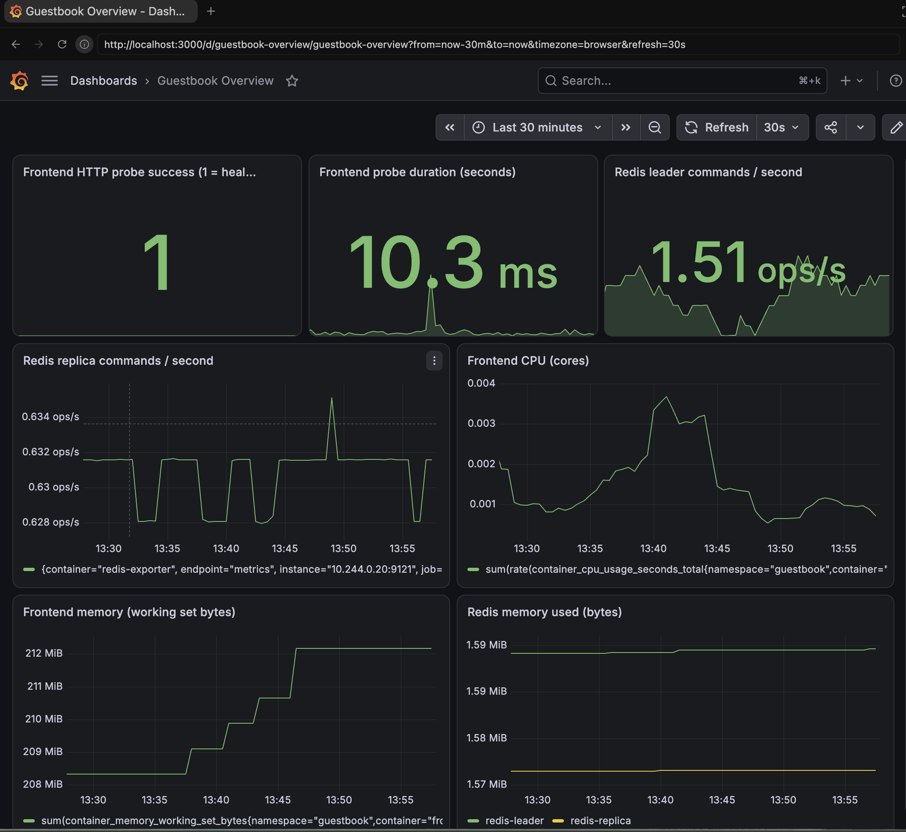
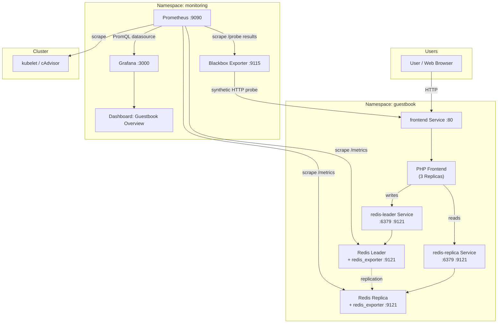
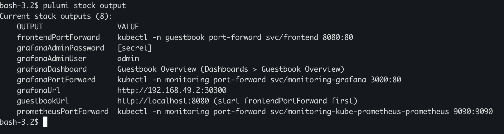
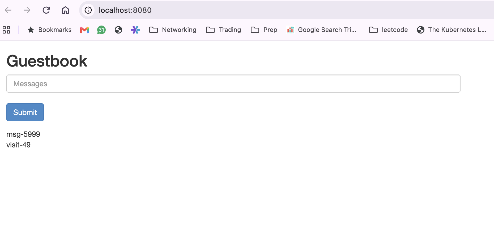
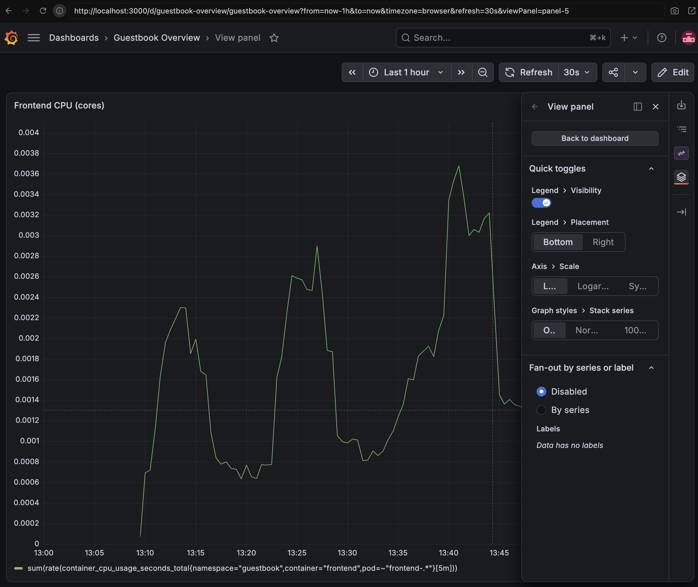
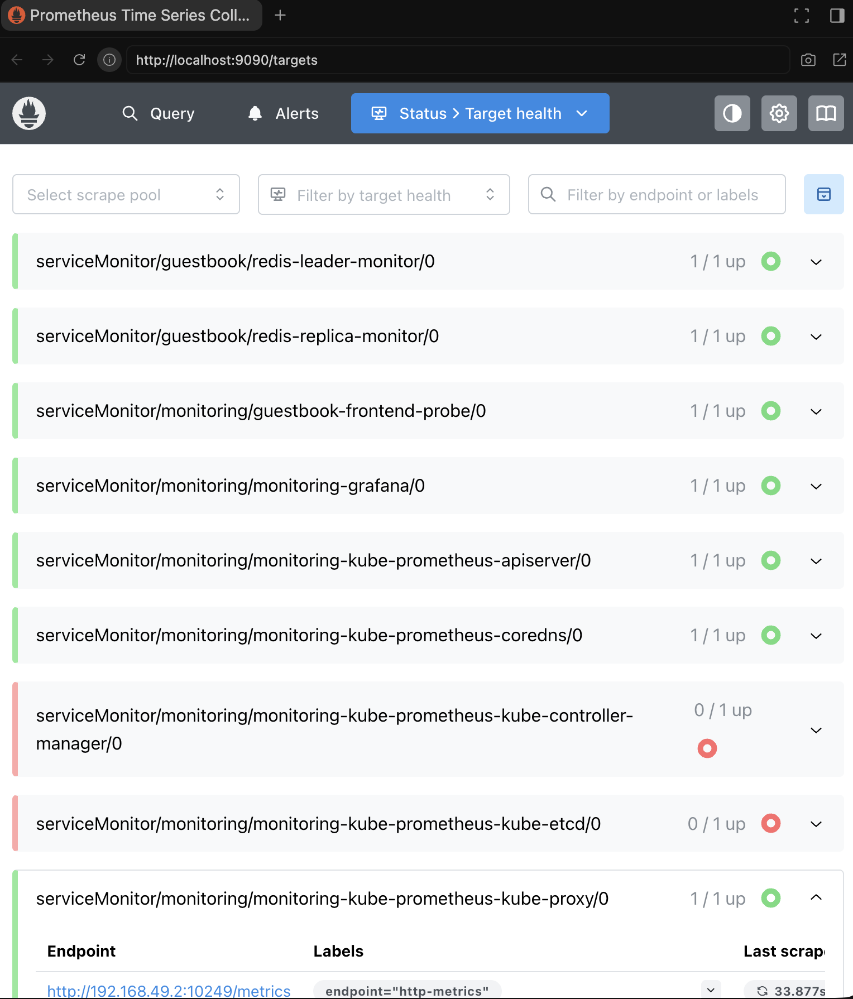
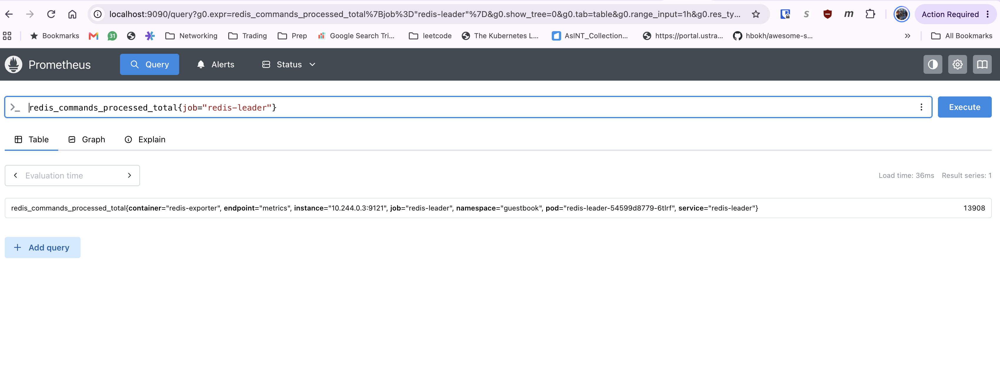

# Guestbook + Prometheus + Grafana (Pulumi / TypeScript)

Extends the upstream [Pulumi Kubernetes Guestbook](https://github.com/pulumi/examples/blob/master/kubernetes-ts-guestbook/simple/index.ts) with a full monitoring stack: Prometheus, Grafana, Redis metrics exporters, a blackbox HTTP probe, and a pre-provisioned Grafana dashboard — all deployed via a single `pulumi up`.

Verified end-to-end on **Minikube** (the instructions below).



---

## What Gets Deployed

| Namespace | Resources |
|---|---|
| `guestbook` | PHP Frontend (3 replicas), Redis Leader + Replica, each with a `redis_exporter` sidecar |
| `monitoring` | kube-prometheus-stack (Prometheus + Grafana + kube-state-metrics + node-exporter), Blackbox Exporter, Grafana Dashboard ConfigMap |

### Metrics collected

| Signal | How | Example PromQL |
|---|---|---|
| Frontend availability | Blackbox HTTP probe | `probe_success{job="guestbook-blackbox"}` |
| Frontend latency | Blackbox HTTP probe | `probe_duration_seconds{job="guestbook-blackbox"}` |
| Frontend CPU | kubelet / cAdvisor | `sum(rate(container_cpu_usage_seconds_total{namespace="guestbook",container="frontend"}[5m]))` |
| Frontend memory | kubelet / cAdvisor | `sum(container_memory_working_set_bytes{namespace="guestbook",container="frontend"})` |
| Redis leader throughput | `redis_exporter` sidecar on port 9121 | `rate(redis_commands_processed_total{job="redis-leader"}[5m])` |
| Redis replica throughput | `redis_exporter` sidecar on port 9121 | `rate(redis_commands_processed_total{job="redis-replica"}[5m])` |

> **Note on frontend metrics:** The PHP frontend has no built-in HTTP request counter. Availability and latency come from the synthetic Blackbox probe; CPU/memory come from cAdvisor. Real request-rate metrics would require instrumenting the PHP app or adding a proxy sidecar.

---

## Architecture



---

## Prerequisites

- **Minikube** — [install guide](https://minikube.sigs.k8s.io/docs/start/)
- **Docker** (or another Minikube driver) — [install guide](https://docs.docker.com/get-docker/)
- **kubectl** — [install guide](https://kubernetes.io/docs/tasks/tools/)
- **Node.js 20+** and **npm**
- **Pulumi CLI** — [install guide](https://www.pulumi.com/docs/iac/download-install/)

The monitoring stack runs ~10 pods total. Minikube needs at least **4 vCPUs and 8 GB RAM**.

---

## Deploy on Minikube

### 1. Start Minikube

```bash
minikube start --cpus=4 --memory=8192
```

### 2. Install dependencies and validate

```bash
npm install
npm test          # validates TypeScript compilation + dashboard JSON
```

### 3. Create the Pulumi stack

```bash
pulumi stack init dev
```

### 4. Configure

```bash
# Set a Grafana admin password (stored encrypted by Pulumi)
pulumi config set --secret grafanaPassword 'YourStrongPassword123!'

# Tell Pulumi this is a Minikube cluster
pulumi config set isMinikube true
pulumi config set grafanaServiceType NodePort
pulumi config set nodeAddress "$(minikube ip)"
```

### 5. Deploy

```bash
pulumi up
```

Pulumi will preview the resources and ask for confirmation. Type `yes`. Deployment takes **2–4 minutes** while images are pulled.

When complete, Pulumi outputs:

```
grafanaUrl           : http://<minikube-ip>:30300
grafanaAdminUser     : admin
grafanaAdminPassword : [secret]
guestbookUrl         : http://localhost:8080 (start frontendPortForward first)
grafanaPortForward   : kubectl -n monitoring port-forward svc/monitoring-grafana 3000:80
frontendPortForward  : kubectl -n guestbook port-forward svc/frontend 8080:80
prometheusPortForward: kubectl -n monitoring port-forward svc/monitoring-kube-prometheus-prometheus 9090:9090
```



Retrieve them at any time:

```bash
pulumi stack output grafanaUrl
pulumi stack output grafanaAdminUser
pulumi stack output grafanaAdminPassword --show-secrets
```

---

## Access Grafana

The most reliable way on Minikube (works on all OS/network combinations):

```bash
kubectl -n monitoring port-forward svc/monitoring-grafana 3000:80
```

Open **http://localhost:3000**

| Field | Value |
|---|---|
| Username | `admin` |
| Password | output of `pulumi stack output grafanaAdminPassword --show-secrets` |

---

## Access the Guestbook

```bash
kubectl -n guestbook port-forward svc/frontend 8080:80
```

Open **http://localhost:8080** and submit a few entries. Each entry is a Redis write and read — you'll see the traffic reflected in Grafana within ~30 seconds.



---

## Grafana Dashboard

The **Guestbook Overview** dashboard is auto-provisioned on deployment (no manual import needed). Find it under **Dashboards → Guestbook Overview**.

It has 7 panels:

| Panel | Metric |
|---|---|
| Frontend HTTP probe success | `probe_success{job="guestbook-blackbox"}` (1 = healthy) |
| Frontend probe duration | `probe_duration_seconds{job="guestbook-blackbox"}` |
| Redis leader commands/sec | `rate(redis_commands_processed_total{job="redis-leader"}[5m])` |
| Redis replica commands/sec | `rate(redis_commands_processed_total{job="redis-replica"}[5m])` |
| Frontend CPU (cores) | `sum(rate(container_cpu_usage_seconds_total{...}[5m]))` |
| Frontend memory (bytes) | `sum(container_memory_working_set_bytes{...})` |
| Redis memory used | `sum(redis_memory_used_bytes{...}) by (job)` |


> Rate-based panels (commands/sec, CPU) need ~5 minutes of samples before showing a line.



### Generate traffic to populate the dashboard

```bash
npm run traffic           # deploys an in-cluster traffic generator Job (~10 min of load)
npm run traffic:stop      # stop it early
```

Or manually post entries through the Guestbook UI at http://localhost:8080.

---

## Verify Prometheus is Scraping

### 1. Check all pods and ServiceMonitors are ready

```bash
kubectl get pods -n guestbook
kubectl get pods -n monitoring
kubectl get servicemonitors -A
```

Expected ServiceMonitors for this app:

```
guestbook    redis-leader-monitor
guestbook    redis-replica-monitor
monitoring   guestbook-frontend-probe
```

### 2. Check Prometheus targets

```bash
kubectl -n monitoring port-forward svc/monitoring-kube-prometheus-prometheus 9090:9090
```

Open **http://localhost:9090/targets** — search for `guestbook`. All three targets should show **State: UP**.



### 3. Run PromQL queries to confirm data is flowing

In the Prometheus expression browser (**http://localhost:9090**) or Grafana's Explore tab:

```promql
# Scrape health
up{job="redis-leader"}
up{job="redis-replica"}
up{job="guestbook-blackbox"}

# Frontend probe
probe_success{job="guestbook-blackbox"}
probe_duration_seconds{job="guestbook-blackbox"}

# Redis activity
rate(redis_commands_processed_total{job="redis-leader"}[5m])
rate(redis_commands_processed_total{job="redis-replica"}[5m])

# Frontend pod resources
sum(rate(container_cpu_usage_seconds_total{namespace="guestbook",container="frontend"}[5m]))
sum(container_memory_working_set_bytes{namespace="guestbook",container="frontend"})
```

All `up` values and `probe_success` should return **1** when healthy.



### 4. Verify exporter endpoints directly

```bash
# Redis metrics
kubectl -n guestbook port-forward svc/redis-leader 9121:9121
curl -s http://localhost:9121/metrics | grep '^redis_up\|^redis_commands_processed_total'

# Blackbox probe result
kubectl -n monitoring port-forward svc/guestbook-blackbox 9115:9115
curl -s 'http://localhost:9115/probe?module=http_2xx&target=http://frontend.guestbook.svc.cluster.local/' | grep '^probe_success\|^probe_duration_seconds'
```

---

## Troubleshooting

| Symptom | Fix |
|---|---|
| Grafana panels show "No data" | Wait 2–3 minutes after deploy. If still empty, run `kubectl -n monitoring rollout restart deploy/monitoring-grafana` — a known Grafana 13 startup race condition with plugin loading can be resolved with a restart. |
| Prometheus target shows DOWN | Check pod logs: `kubectl -n guestbook logs <redis-pod> -c redis-exporter` |
| `probe_success=0` | Verify frontend pods are Ready: `kubectl get pods -n guestbook` |
| NodePort not reachable | Use port-forward instead: `kubectl -n monitoring port-forward svc/monitoring-grafana 3000:80` |
| CRD errors on first deploy | Ensure Kubernetes 1.25+. ServiceMonitors depend on the Helm release and are created after CRDs. |
| Redis replica can't sync | Both leader and replica use `redis:7.4-alpine` — mismatched versions cause RDB format errors. |

---

## Clean Up

```bash
pulumi destroy          # removes all Kubernetes resources
pulumi stack rm dev     # removes the Pulumi stack state
minikube stop           # stops the Minikube VM
```

> Helm leaves `monitoring.coreos.com` CRDs behind after `pulumi destroy`. On a disposable cluster you can remove them with `kubectl delete crd -l app.kubernetes.io/part-of=kube-prometheus-stack`.

---

## Repository Structure

```
.
├── index.ts                  # Pulumi program — all resources defined here
├── dashboards/
│   └── guestbook.json        # Grafana dashboard (auto-provisioned via ConfigMap)
├── scripts/
│   ├── check-dashboard.cjs   # Validates dashboard JSON shape and PromQL queries
│   ├── traffic-job.yaml      # Kubernetes Job that generates sustained load
│   └── generate-traffic.sh   # Local script to generate load via port-forward
├── Pulumi.yaml               # Stack name and runtime
├── package.json              # npm scripts: build, test, traffic, traffic:stop
└── tsconfig.json             # TypeScript compiler config
```

## npm Scripts

```bash
npm test            # TypeScript check + dashboard validation
npm run build       # TypeScript type-check only
npm run traffic     # Deploy in-cluster traffic generator
npm run traffic:stop# Stop traffic generator
```

---

## References

- [Pulumi Guestbook original](https://github.com/pulumi/examples/blob/master/kubernetes-ts-guestbook/simple/index.ts)
- [Pulumi Kubernetes Helm Release docs](https://www.pulumi.com/registry/packages/kubernetes/api-docs/helm/v3/release/)
- [kube-prometheus-stack Helm chart](https://artifacthub.io/packages/helm/prometheus-community/kube-prometheus-stack)
- [redis_exporter](https://github.com/oliver006/redis_exporter)
- [Blackbox exporter](https://github.com/prometheus/blackbox_exporter)
